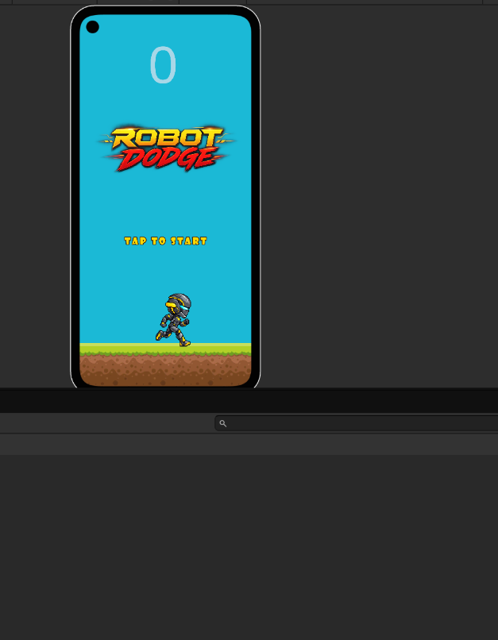
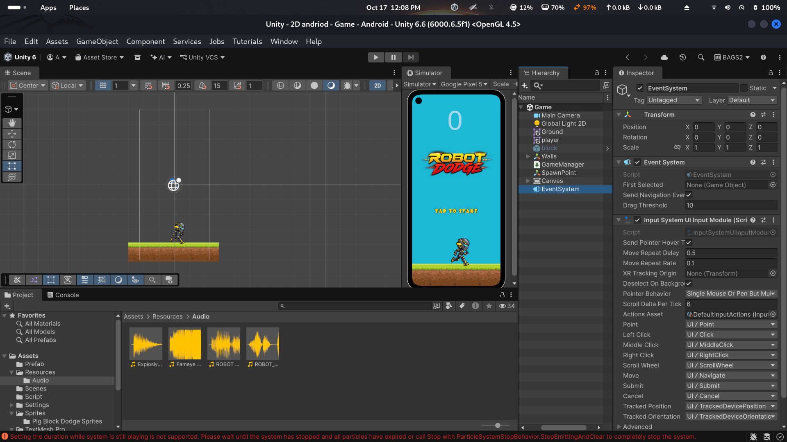

# Robot Dodge

Robot Dodge is a 2D arcade game for Android, built with Unity. Move the robot from side to side, dodge falling blocks, and beat your score.

## Screenshots

## Play

The Android build is included at [`AndriodBuild/Robot Dodge.apk`](AndriodBuild/Robot%20Dodge.apk). Copy it to an Android device and open it to install. Android may ask you to allow installation from that source.

Tap the start screen. The robot ready cue plays before blocks begin spawning. Hold a position on the left or right side of the screen to move the robot toward that side. The score increases as blocks spawn. Hitting a block ends the run, shows the final score, and plays the crash and game-over sounds. Tap the game-over screen to start again.

## Open the project

1. Open this folder in Unity Hub with Unity `6000.6.5f1` or a compatible Unity 6 version.
2. Open `Assets/Scenes/Game.unity`.
3. Press **Play** to run it in the Editor, or select the Android build profile to build for a device.

## Project structure

- `Assets/Scenes` — game scene
- `Assets/Script` — player, obstacle, and game manager scripts
- `Assets/Prefab` — obstacle prefab
- `Assets/Resources/Audio` — gameplay music and sound effects
- `AndriodBuild` — Android APK

# RebotDodge
